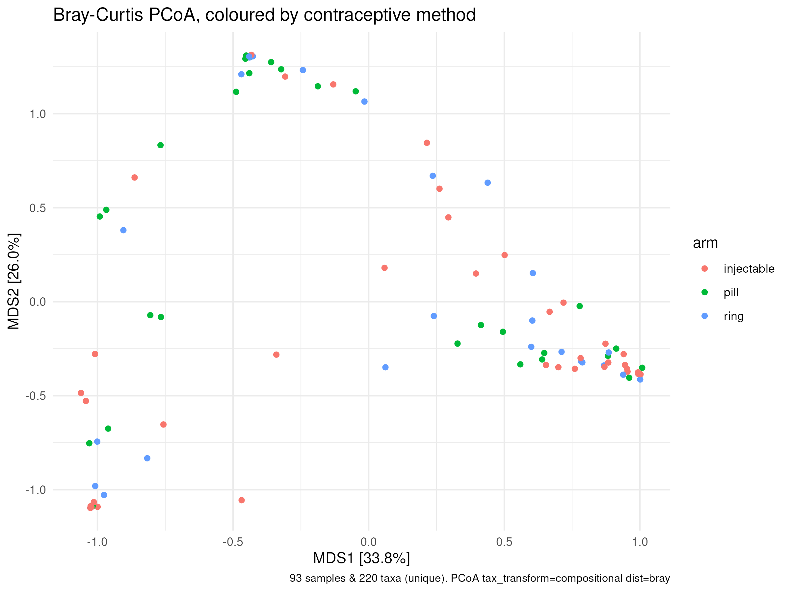
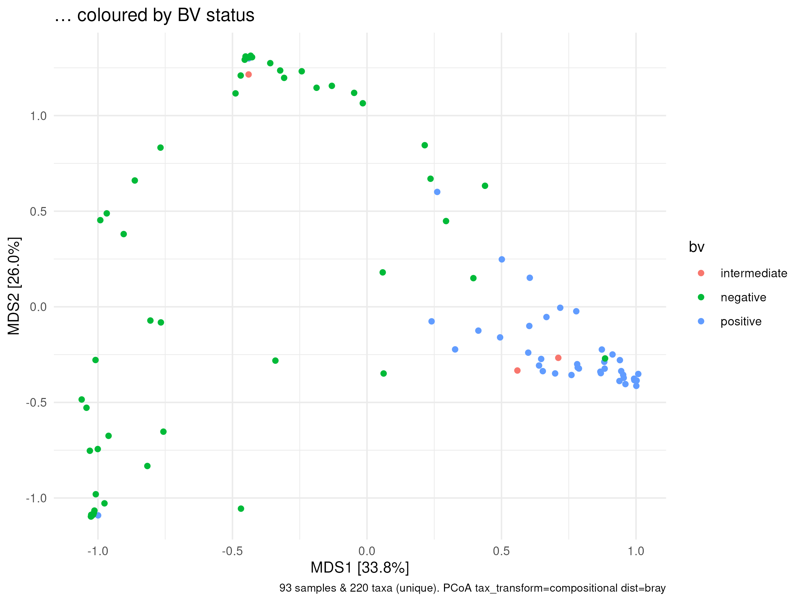
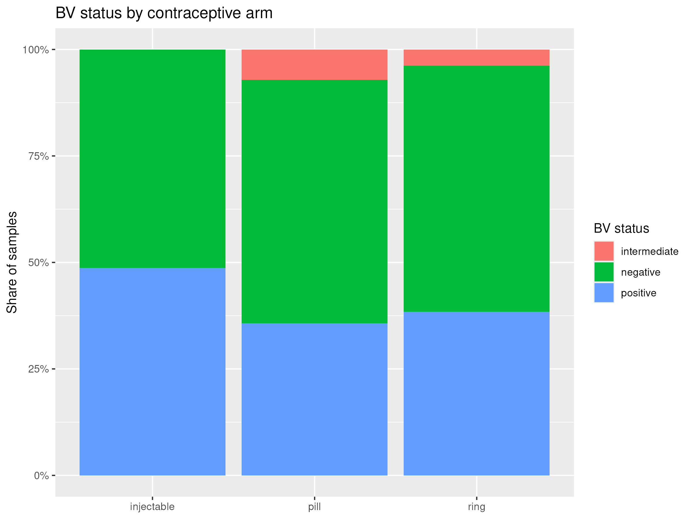

---
format:
  revealjs:
    theme: default
    slide-number: true
    smaller: true
    footer: "Data Science for Biology — group project"
---

## Question 1 — Do the three contraceptive methods differ in community composition?

### Study B — 93 participants, one vaginal sample each

**What we did:**

- **Quality-checked** both count tables (depth, zeros, batch)
- **Filtered: nothing deleted** — 9 low-depth samples (< 15,000 reads)
  were *flagged* and retested without as a sensitivity check, never
  dropped from the main test
- **Main test:** PCoA map + PERMANOVA on Bray-Curtis distance of
  **relative abundances** (999 permutations, seed 202)
- Pairwise arm comparisons with **Holm correction** for three tests

::: {.notes}
The 15,000 rule was picked from the depth histogram alone, never from
the test result. Relative abundances so shallow samples are not
punished for being shallow.
:::

## Q1 — the map, and what actually separates the samples

::: columns
::: {.column width="50%"}

**"Three overlapping crowds, not three islands."**
Arm alone: **R² = 3.3%, p = 0.147**. After BV, pH, STI and batch had
their share: **R² = 2.7%, p = 0.108**.
:::
::: {.column width="50%"}

**"What separates them is BV — not the method."**
BV: **R² = 14.3%, p = 0.001**. Pill vs injectable, alone:
**R² = 3.9%, p = 0.033** (→ **0.099** Holm-corrected).
:::
:::

::: {.notes}
Left: each point is one participant's community; close points have
similar communities. If the methods differed, colours would form three
islands. Right: the same map coloured by BV makes the real structure
visible — BV-negative top left, BV-positive bottom right.
:::

## Q1 — choices we made, and the answer

| Choice | Route A | Route B | **Kept** |
|---|---|---|---|
| Distance | Bray-Curtis on relative abundances | on raw counts (draft 1) | **A** — raw counts punish the 9 shallow samples |
| Pairwise tests | Holm-corrected | raw p-values | **A** — three tests, three chances to be fooled |

**Source we opened:** Anderson (2001), the PERMANOVA paper —
<https://doi.org/10.1111/j.1442-9993.2001.01070.pp.x>

> **Answer to Question 1: No.** Method explains **3.3%** (p = 0.147);
> every alternative distance agrees. The one hint — pill vs injectable,
> p = 0.033 — falls to **0.099** after correction. (A sanity check
> agrees: median *Lactobacillus* share **84.8%** pill vs **45.3%**
> injectable / **44.7%** ring.)

::: {.notes}
Robustness table (02 §4): raw-count Bray, Aitchison and Jaccard all
leave arm at ~3%, non-significant. Whether "is BV hiding in one arm?"
matters for this answer — that is Question 2.
:::

## Question 2 — Is bacterial vaginosis more common in one arm?

### (Tuesday's anatomy module: look at the table before testing it)

**What we did:**

- **Validated the `bv` column first:** label vs Nugent score agreed in
  **93/93** samples — safe to use
- **Kept all 93 samples** — BV status comes from the Nugent score, not
  sequencing depth, so shallow samples are still valid rows here
- **Tested:** Fisher's exact test (two cells held < 5 samples, so
  chi-square was unreliable), three BV categories *and* collapsed to
  any-BV-vs-none
- **Sanity check from biology:** BV-positive samples should carry more
  *Gardnerella*

**Source we opened:** the R documentation for `fisher.test`
(`?fisher.test`)

::: {.notes}
Both BV definitions were run so the verdict does not hinge on where
"BV" is drawn.
:::

## Q2 — the figure, the numbers, and the answer

::: columns
::: {.column width="42%"}

*Caption:* "The share of each arm that is BV-negative, intermediate or
positive."
:::
::: {.column width="58%"}
| Arm | any BV | positive only |
|---|---|---|
| injectable | **48.7%** | 48.7% |
| pill | **42.9%** | 35.7% |
| ring | **42.3%** | 38.5% |

**Fisher's exact test:** p = **0.454** (3 categories), p = **0.897**
(any BV vs none).

**Sanity check:** median *Gardnerella* share — **24.6%** in BV-positive
vs **1.1%** in BV-negative. The labels mean something.

> **Answer to Question 2: No.** BV is common (~42–49%) everywhere; no
> arm is protected or penalised. So BV dominates the communities (Q1:
> R² = 14.3%) but is **a rival explanation, not a confounder**.
:::
:::

::: {.notes}
With 26–39 per arm, even the largest gap (13 points) is within chance.
:::

## What we do not believe — and the questions we ask next

**We do not believe:** "no difference" means no difference *exists*
(26–39 per arm can miss a modest effect); the pill-vs-injectable hint
(it does not survive correction); that our distance sees everything
(arm effects could hide under the BV signal); or that the arms were
comparable at baseline (observational, not randomised).

| Question | Answer |
|---|---|
| **Do the gene differences match the pill-vs-injectable hint?** | Not tested yet — we expect mostly no, since the hint fell to p ≈ 0.10 |
| **Does BV leave a mark on the immune data (cytokines)?** | We expect yes — BV-positive samples already carry 24.6% *Gardnerella* vs 1.1% |
| **Do cytokines differ by arm?** | Open — the immune readout is where an arm effect could still hide |
| **Which *Lactobacillus* dominates, *crispatus* or *iners*?** | Checked now: ***iners* peaks in the pill arm** (17.3% vs 9.0% ring, 1.8% injectable); *crispatus* tracks BV (28.2% negative vs 0.1% positive), not arm |
| **Does composition shift gradually with Nugent 0–10?** | Expected yes — three categories may hide a dose–response |
| **Is pH the middleman?** | Checked now: pill's median pH is **4.55** vs **5.0** in the other arms, and pH tracks BV (4.4 negative → 5.0 positive) — a look, not a test |

::: {.notes}
The two "checked now" answers are looks at the data, not tests — they
still need formal analysis. Cross-table habit applies throughout:
define the group from one table, test the other.
:::
