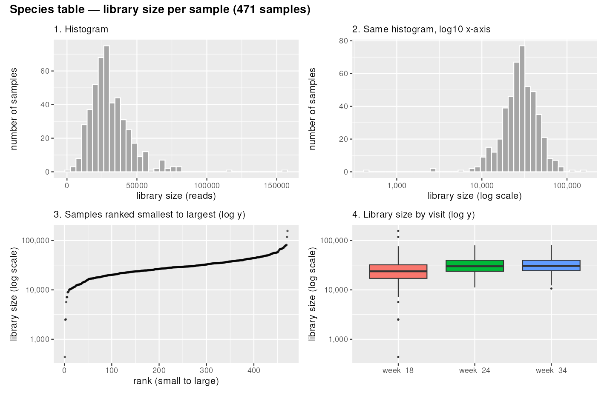
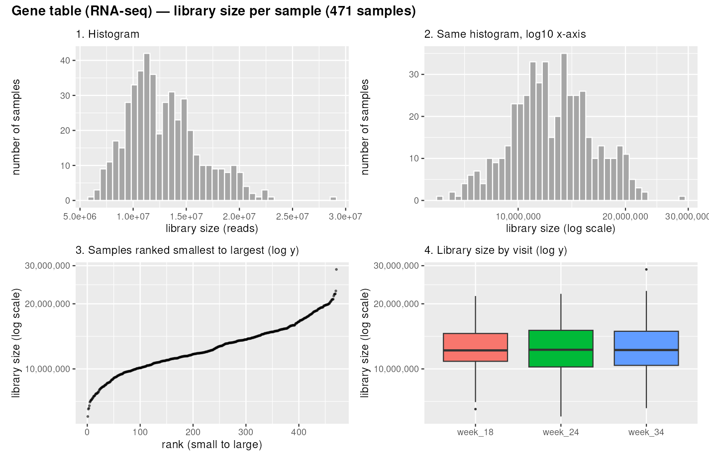
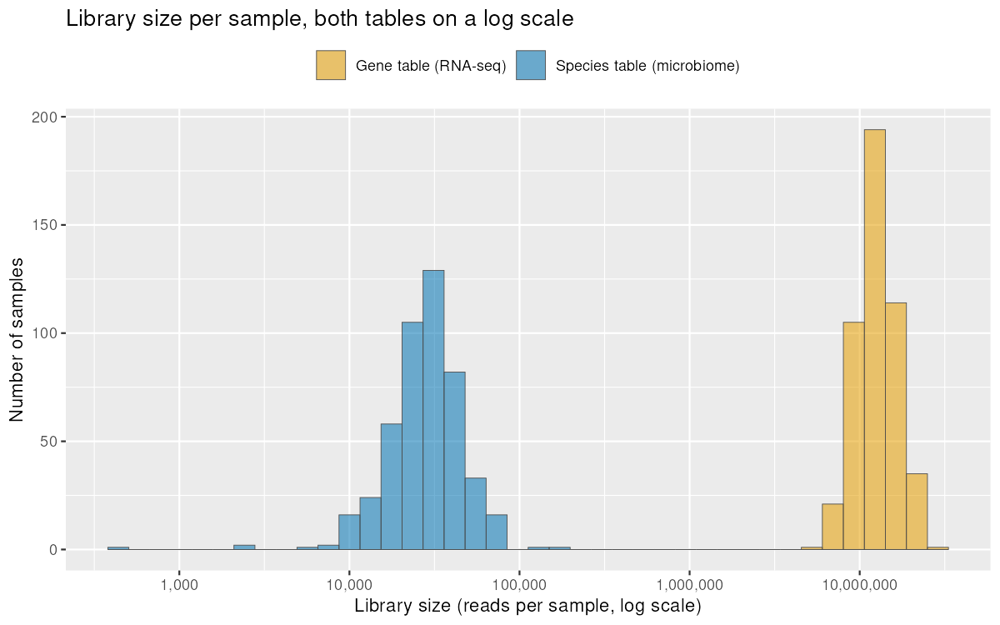
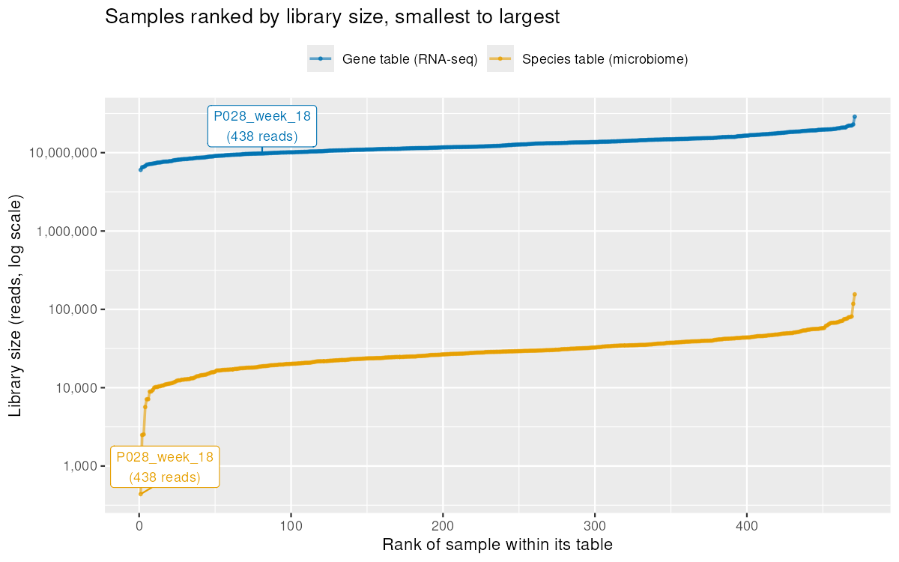
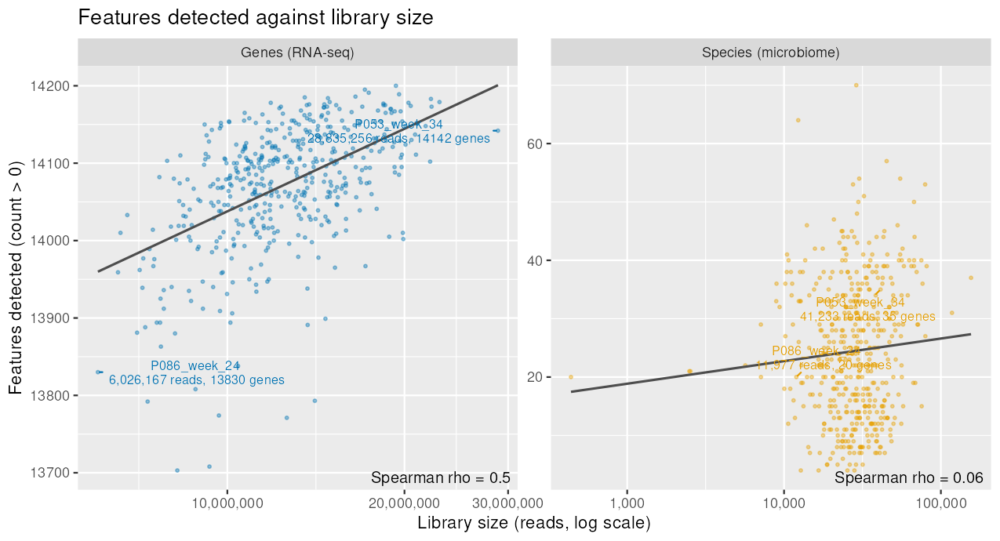
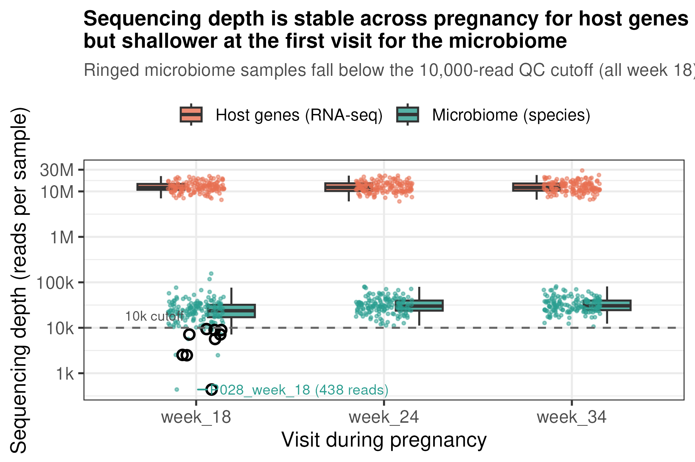

> In this module Pi writes the code. Your job is to ask for numbers and plots,
> look at each one, and decide what they mean. Ask Pi to put its code under the
> step you are working on. Every step ends with something for you to check or
> decide: write your answers here.

```{r setup}
library(tidyverse)
library(here)

data_dir <- "data/2-workshop2/instructional_dataset"

metadata <- read_csv(here(data_dir, "01_metadata.csv"))
species  <- read_csv(here(data_dir, "02_microbiome_counts.csv"))    # 220 species  x 471 samples
genes    <- read_csv(here(data_dir, "04_rnaseq_counts.csv.gz"))     # 14,226 genes x 471 samples
taxonomy <- read_csv(here(data_dir, "03_microbiome_taxonomy.csv"))
```

```{r}
metadata
```

# Exercise 1: Many looks at the same two tables

## Part 1 — Predict (no code)

Answer before running anything below.

**1. Of the 220 species, how many will you see in a single sample?**

- 10

**2. Of the 14,226 genes, how many will you see in a single sample?**

- several thousands

**3. Which table has a larger share of zero cells?**

- species table

**4. One sample has 438 bacterial reads against a median of about 28,700. What will be wrong with it?**

- low sequencing depth

**5. A typical sample behaves like how many equally common species? Like how many equally expressed genes?**

- 3 species, 1000 genes

## Part 2 — Ask, look, decide

### Step 1: the per-sample numbers

Suggested request: *In step 1 of my notebook, make one data frame with a row
for every sample in each count table, species and genes, and a `table` column
saying which. Columns: library size, number of features detected, fraction of
zeros, the share held by the largest feature, Shannon diversity, and the
effective number of features.*

```{r step1-per-sample}
# One row per sample, for both count tables.
# Count tables are features in rows, samples in columns, so everything
# here is computed column-wise (one column = one sample).

per_sample <- function(counts, table_name) {
  counts <- as.matrix(counts[-1])           # drop the feature-id column, keep the 471 sample columns
  lib    <- colSums(counts)                 # library size: total counts in the sample
  p      <- sweep(counts, 2, lib, "/")      # each cell as a share of its sample's library size
  p[p == 0] <- NA                           # log2(0) is undefined; its contribution is 0, so drop it
  shannon <- -colSums(p * log2(p), na.rm = TRUE)  # Shannon diversity, log base 2

  tibble(
    table             = table_name,
    sample            = names(lib),
    library_size      = lib,
    features_detected = colSums(counts > 0),        # nonzero cells
    fraction_zeros    = 1 - colMeans(counts > 0),   # share of all cells that are zero
    max_feature_share = apply(counts, 2, max) / lib, # biggest single feature's cut
    shannon           = shannon,
    effective_features = 2^shannon                   # how many equally common features it behaves like
  )
}

sample_summary <- bind_rows(
  per_sample(species, "species"),
  per_sample(genes,   "genes")
)
sample_summary
```

- Does it have 942 rows, 471 for each table?
  - *Your answer:*
- Type `sum(species$P001_week_18)` in the console. Does it match Pi's library size for that sample?
  - *Your answer:22756
- Is features detected never more than 220 (species) or 14,226 (genes)?
  - *Your answer:14,226

### Step 2: a short report

Suggested request: *Under that data frame, add a summary table with the median,
smallest and largest value of every column, separately for each table. Then
write three sentences about anything unusual.*

```{r step2-summary}
# Median, min and max of every numeric column, one block of rows per table.
summary_stats <- sample_summary |>
  group_by(table) |>
  summarise(across(where(is.numeric),
                   list(median = median,
                        min    = min,
                        max    = max))) |>
  # reshape so each row is one column-of-the-data-frame, easy to read down
  # names_pattern splits at the LAST underscore, so "library_size_median"
  # becomes column = "library_size", statistic = "median"
  pivot_longer(-table,
               names_to = c("column", "statistic"),
               names_pattern = "(.*)_(.*)") |>
  pivot_wider(names_from = statistic, values_from = value)

summary_stats
```

The three sentences:

1. One species sample has a library size of only **438 reads**, against a
   median near 28,700 (next smallest 2,489) — and its other measurements all
   sit inside the normal range (features_detected 20 vs median 24,
   `max_feature_share` 0.29 vs median 0.602), so depth is its only flagged
   problem, but a reason to consider dropping it.
2. Species samples behave like only ~`r round(summary_stats$median[summary_stats$column == "effective_features" & summary_stats$table == "species"], 1)`
   equally common species (median `effective_features`), while gene samples
   behave like ~`r round(summary_stats$median[summary_stats$column == "effective_features" & summary_stats$table == "genes"], 0)`
   equally common genes — the species table is far more lopsided.
3. The gene table is the opposite: almost no zero cells at all (median
   `fraction_zeros` ≈ 0.01), because nearly every gene is expressed in every
   sample, and its `max_feature_share` is small too (median ≈ 0.08) — no single
   gene hogs a sample the way a species can in a shallow one.

- Which medians were furthest from your Part 1 answers?
  - *Your answer: species effective_features, genes features_detected*
- Did Pi mention the 438-read sample? Did it claim anything you cannot find in the table?
  - *Your answer:* yes, yes

### Step 3: one number, four plots

Suggested request: *Plot the library size of every sample four ways: a
histogram, the same histogram on a log scale, the samples ranked from smallest
to largest, and library size by visit. Use both tables.*

- Which view makes the 438-read sample obvious, and which hides it? Which would you put in a paper?
  - *Your answer: The ranked view makes it obvious, while the histogram might hide it.*

The four views, one figure per table:





Both tables on one log axis, overlaid:



Both tables ranked, with the 438-read sample labelled:



### Step 4: features detected against library size

From here on, write your own requests. Ask for the plot and the Spearman
correlation for each table, then ask how many extra genes the correlation
amounts to between the shallowest and the deepest samples.

- How many extra genes, out of 14,226? 
  - *Your answer:* about 300 which is roughly 2% of the gene table. The shallowest sample uses 97% of all genes.
Does the plot agree with Pi?  yes it does. The spearman correlation is 0.50 which is a moderate positive relationship and the gap from 6M to 29M reads is worth about 240 genes.



### Step 5: which samples to drop

Ask Pi to suggest a minimum library size and explain it. Then ask how many
samples cutoffs of 1,000, 5,000, 10,000 and 20,000 reads would drop, and from
which visits and outcomes.

*The cutoff I chose, and why:* the suggested cut off was 10,000 reads. the median is 28,700. samples below 10k which is 2% of samples carry only 0.36% of reads. the depth below that means relative abundance noise dominates. 20,000 was rejected: it drops 96 samples (20% of all), all skewed to week 18, which would confound depth with visit.

- When you asked what happens if you keep the dropped samples, did Pi's answer agree with its first reason?
  - *Your answer:* shallow samples are compositional with noise. the community looks like a handful of dominant species at inflated shares so they would cluster together in any ordination and show artificially low diversity. The answer agrees with the first reason, which is depth — and the harm of keeping them shows up exactly where depth matters most, in the effective number of species.


### Step 6: polish one figure

Improve one plot a request at a time: axis titles in words, log-axis labels
like 1k and 10k, your own two colours, text readable from the back of the room,
saved as a 6 by 4 inch PNG. Then ask for one thing you would not know how to
code yourself.

- Which request got you furthest? How did "make it look nicer" compare with a specific request?
  - *Your answer:* The log-axis labels got furthest — they changed what the plot could tell you at a glance. "Make it look nicer" made Pi guess my taste; the specific requests each moved the plot one guaranteed step.

The polished figure, with the QC decision baked in:



### Step 7: argue with it

Ask which logarithm `log()` is in R, then what the effective number would be if
the Shannon formula used `log2()`.

- Did the effective number change? Did Pi say it would?
  - *Your answer:* `log()` in R is the natural log (base e). Switching Shannon to `log2()` consistently (exponentiating with `2^`) changes nothing: median effective species 3.25 either way, median effective genes 1,055 either way — the log's base cancels against the base of the exponent. It only changes if you mix bases (log2 inside, exp() outside): species 3.25 → 5.47, genes 1,055 → 23,008. Pi's answer: no change if consistent, a big fake change if mixed.

# Exercise 2: Filters are choices

Type `/new` in Pi before you start. Step 5 builds a file that this afternoon's
notebook reads. If you are short on time, do step 5 first.

## Part 1 — Predict (no code)

**1. Keeping only species present in at least 10% of samples: how many of the 220 survive, and what share of reads is lost?**

- *Your answer:* 59 of the 220 survive, and only about 0.8% of reads are lost (checked in Step 1 below). Dropping ~73% of the species costs under 1% of the reads because the dropped species are the rare ones, present in only a handful of samples.

**2. The same 10% rule applied to 14,226 genes: how many survive?**

- *Your answer:* all 14,226 survive (0.0% of reads lost). Almost every gene is transcribed in almost every sample, so nearly all genes already appear in ≥47 of the 471 samples. Opposite of the species table, which is full of rare bacteria. See Step 1 below.

**3. To compare one species between two samples, what must you do to the counts first?**

- *Your answer:* normalise for library size first — divide each sample's counts by its total reads (e.g. relative abundance or CPM). Raw counts depend on sequencing depth, so a deeper sample looks like it has more of everything; dividing puts both samples on the same scale. Two caveats: this fixes depth but not composition (if one abundant species grows, every other species' share shrinks even if its own count didn't), and never feed normalised counts to DESeq2 — it wants raw counts and normalises internally.

**4. If you drop the rare species, does the effective number of species in a sample go up, go down, or stay about the same?**

- *Your answer:* about the same, drifting slightly down: median effective number 3.23 → 3.10 (−0.3%). Rare species hold tiny read shares, so their contribution to Shannon diversity (p·log₂(1/p)) is small and removing them barely moves it — the effective number is decided by the common species. The exception is the check in Step 3: in a few week-18 samples the effective number drops by 23–52% (e.g. P017_week_18, 6.29 → 3.05), because those samples contained a species that is rare across the cohort but abundant in them — the filter removes genuinely important features from exactly those samples.

## Part 2 — Ask, look, decide

### Step 1: prevalence and the filter curve

Ask for each feature's prevalence in both tables and its distribution, then the
filter curve: for cutoffs from 0 to 0.9, features kept and share of counts kept.

```{r ex2-step1-prevalence}
# Prevalence = in how many samples a feature appears (nonzero count).
# Count tables are features in rows, samples in columns, so this is rowSums.
sp_counts <- as.matrix(species[-1])          # drop the feature-id column
sp_prev   <- rowSums(sp_counts > 0) / ncol(sp_counts)  # prevalence as a fraction

# The filter curve: features kept and share of reads kept, for each cutoff
cutoffs <- seq(0, 0.9, by = 0.1)
filter_curve <- tibble(
  cutoff        = cutoffs,
  features_kept = sapply(cutoffs, function(c) sum(sp_prev >= c)),
  reads_kept    = sapply(cutoffs, function(c) {
                    keep <- sp_prev >= c
                    100 * sum(sp_counts[keep, ]) / sum(sp_counts)
                  })
)
filter_curve
```

```{r ex2-step1-genes}
# Same 10% rule on the gene table
gn_counts <- as.matrix(genes[-1])
gn_prev   <- rowSums(gn_counts > 0) / ncol(gn_counts)
c(sum(gn_prev >= 0.10),            # genes kept
  100 * sum(gn_counts[gn_prev < 0.10, ]) / sum(gn_counts))  # % reads lost
```

- At 10%, does the species table keep 59 of 220 and lose about 0.8% of reads? Does the gene table keep all 14,226?
  - *Your answer:* Yes to both. Species: 59 of 220 kept, 0.8% of reads lost. Genes: all 14,226 kept, 0.0% of reads lost — almost every gene is expressed in at least 47 samples, so a 10% prevalence cutoff removes nothing. The two tables are opposites: the species table is dominated by rare features, the gene table is not.

### Step 2: a grid of filters

Ask for features kept and share of counts kept for every combination, as one
summary table and then as a plot:

- species: prevalence 5%, 10% or 25%, crossed with mean relative abundance 0, 0.01% or 0.1%
- genes: mean CPM 1, 5 or 10, crossed with prevalence 0%, 50% or 90%

*Why I filtered the species table this way:*

*Why I filtered the gene table this way:*

- What did your neighbour choose?
  - *Your answer:*

### Step 3: did the filter change anything you care about?

Ask for each sample's effective number of species before and after your filter,
as a scatter plot with a 1:1 line. Then the same for features detected.

- Which number moved, and why did the other barely move?
  - *Your answer:*

### Step 4: normalise, then log

Ask for counts per million and `log2(cpm + 1)`, histograms of one species and
one gene before and after the log, then the same gene with `+ 0.5`, `+ 1` and
`+ 10`.

- Where does the `+ 1` change the picture, and where does it make no difference?
  - *Your answer:*

### Step 5: THE IMPORTANT ONE, the grouping column

Suggested request: *From the full species table, before any filtering, compute
the fraction of each sample's reads that belong to the genus Lactobacillus. Use
`03_microbiome_taxonomy.csv` to find which species those are. Add a column
called `community` that is `lactobacillus` if the fraction is 0.5 or more and
`anaerobe` if it is below 0.5. Save `sample_id`, `lacto_fraction` and
`community` to `data/my_sample_groups.csv`.*

This afternoon's notebook reads that file back, and so does Wednesday's.

- Which species names did Pi count as Lactobacillus? Should any of them not be there?
  - *Your answer:*
- Smallest and largest `lacto_fraction`? Both should be between 0 and 1.
  - *Your answer:*
- One sample's Lactobacillus counts divided by its total, worked out by you. Does it match?
  - *Your answer:*

### Step 6: the 0.5 cutoff

Ask for a histogram of `lacto_fraction` with a line at 0.5, how many samples
change group at 0.3 or 0.8, and how the split across visits changes. Then ask
Pi to justify 0.5.

- Is its reason about this data, or would it say the same about any dataset?
  - *Your answer:*

### Step 7: diversity by community

Ask for the effective number of species in each community group, as a boxplot
on a log scale.

- Which group is more diverse? Is that what you would call healthy?
  - *Your answer:*

### Step 8: bar charts and heatmaps

Ask for the microViz bar chart of the 10 largest genera and a heatmap of the 20
largest with `community` as a strip along the top, then the same for genes by
gene symbol. Then ask for variations: bars ordered by `lacto_fraction`, split by
community, 20 genera instead of 10.

- Which version tells you the most?
  - *Your answer:*
- Two genes whose heatmap rows look alike, and what they do (check one on NCBI Gene yourself):
  - *Your answer:*

## Part 3 — Reach (optional)

Ask Pi to turn this notebook into a short QC report as a new Quarto document,
ending in `## Choices made` with every cutoff and filter you chose and one
alternative for each. Render it. Then ask Pi to run the same report on
`group_a_probiotic` or `group_b_contraception`, changing only the data folder.

- Is every choice you made today in the Choices made list? Did the report need more changes than the data folder?
  - *Your answer:*
